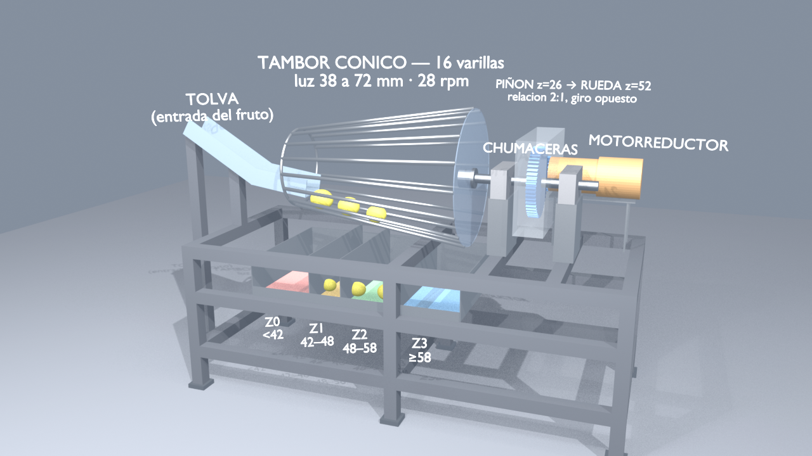

# Tahiti Lime Sorter: Conical Rod-Drum Design

Concept design of a machine that grades Tahiti limes by diameter, with a parametric Blender model and animation that uses the same dimensions as the design report. Mechanical design course, group project (ED-01).



## The design

- **Principle:** a conical drum of 16 rods (Ø12 mm, L = 600 mm) between two rings (Ø256 and Ø431). The gap between rods grows from 38 to 72 mm; the drum turns at about 28 rpm on a horizontal axis, tumbling the fruit forward until the gap exceeds its diameter and it falls through.
- **Four outputs:** < 42 mm (reject), 42-48, 48-58 and 58 mm and over (size classes from Codex Stan 213).
- **Drive:** coaxial gear-motor, 26-tooth pinion to 52-tooth wheel (module 4, ratio 2:1), two pillow-block bearings, overhung drum, welded 40x40x2 frame.
- **Why not parallel rollers** (first concept): the fruit would not rotate and the bearings clashed; documented as a rejected alternative.

## What is in the repo

| Path | What |
|---|---|
| `blender/crear_maquina.py` | Builds the full machine in Blender from the report's parameters (mm) and animates it |
| `blender/maquina_clasificadora.blend` | Generated scene |
| `blender/maquina_funcionando.mp4` + `vista_cuadro_*.png` | Rendered animation and stills |
| `figures/` | 14 report figures: context, functional diagram, decomposition, alternatives A/B/C, orthographic views, isometric |

```bash
blender -b -P blender/crear_maquina.py                # build .blend
blender -b -P blender/crear_maquina.py -- --anim      # also render the mp4
```

## Status (honest)

🟡 Concept stage. The axial feed speed of the fruit (50 mm/s) in the animation is an **illustrative assumption**: in the real design it must be measured in a SolidWorks Motion Study, which is not part of this repo. The written report is not included. UI and comments are in Spanish.

## Folder guide

| Folder | What it holds |
|---|---|
| [blender/](blender/README.md) | Blender generator, scene, animation and stills |
| [figures/](figures/README.md) | Report figures |

---

Built by Monoga · [github.com/Monoga2025](https://github.com/Monoga2025)
